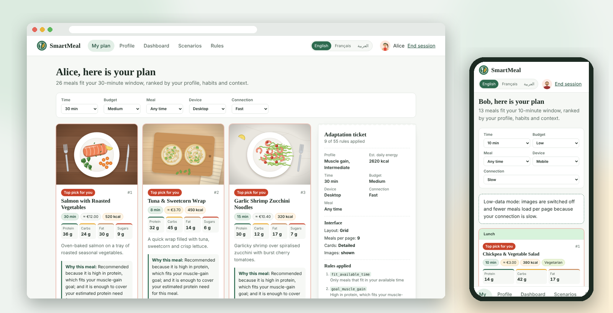
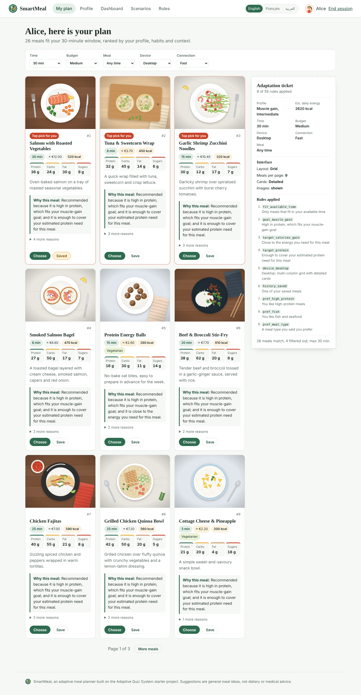
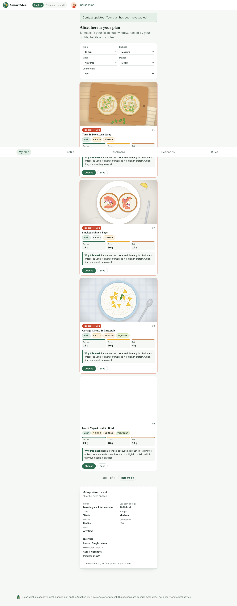
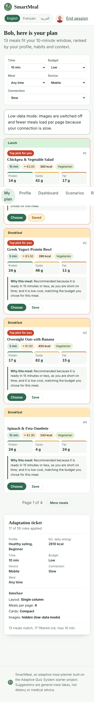
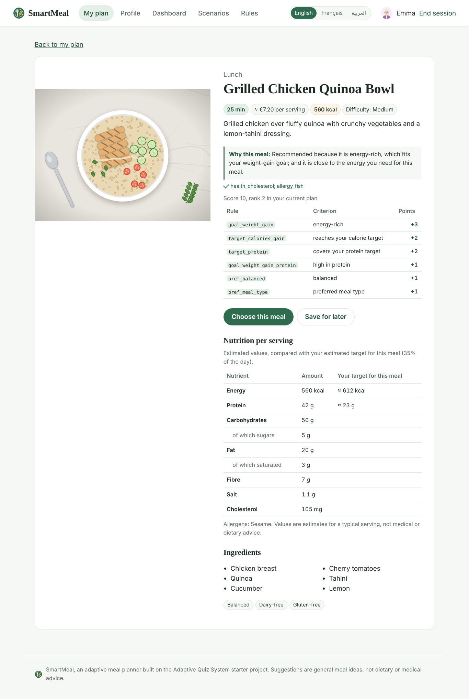
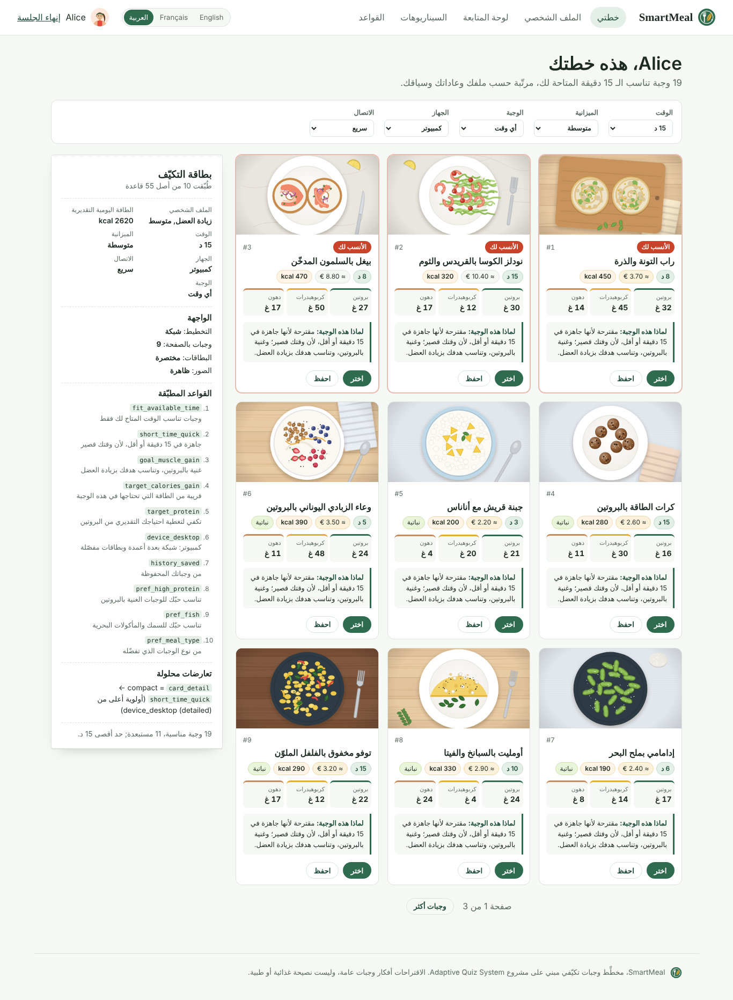
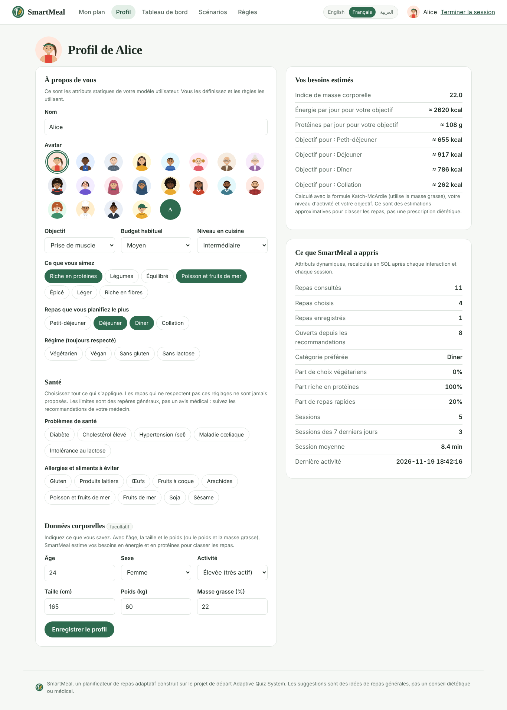
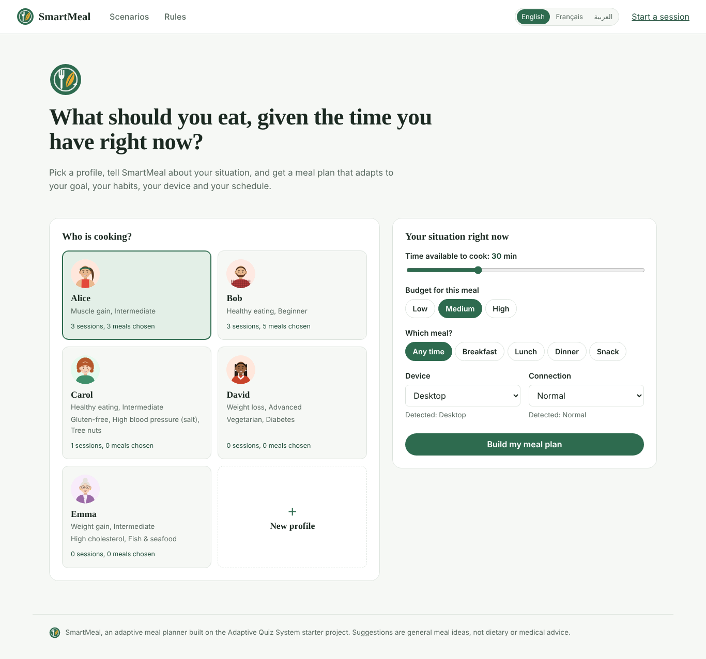
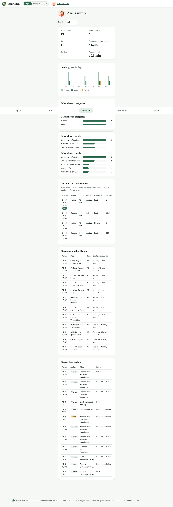
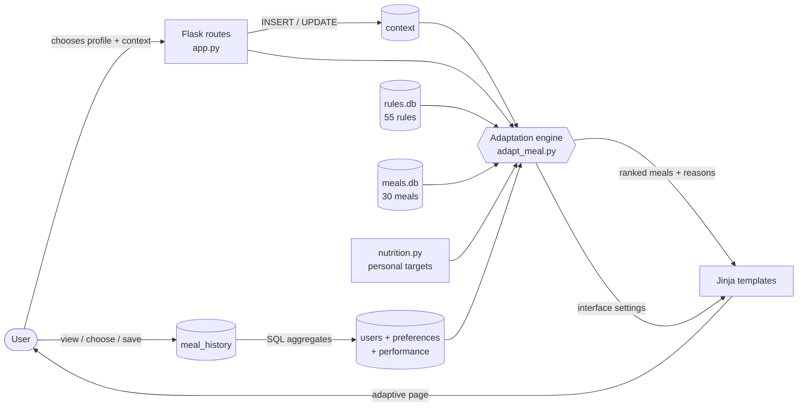

<p align="center">
  
</p>

<h1 align="center">SmartMeal – Adaptive Meal Planner</h1>

<p align="center">
  A context-aware, rule-based meal recommender that adapts both <b>what</b> it suggests and <b>how</b> the interface looks,<br>
  using the user profile, the current context and adaptation rules stored in SQLite.
</p>

<p align="center">
  
  
  
  
  
</p>

<p align="center">
  
</p>

---

## Project team

| | |
|---|---|
| **Authors** | **Walid Najjar** and **Manel Kalloud** |
| **Programme** | Master 2 HSIM (Human & System Intelligence for Management) |
| **University** | IAE Lyon School of Management, Université Jean Moulin Lyon 3 |
| **Course** | Adaptive Interactive Systems |
| **Instructor** | Élise Lavoué |
| **Academic year** | 2026/2027 |
| **Starting point** | Built on the *Adaptive Quiz System* starter project provided by the instructor. That project is not included here: this repository only contains our own work. |

> Meal suggestions, nutrition values and health limits are generic estimates for an academic prototype,
> not medical or dietary advice.

---

## Table of contents

1. [About the project](#1-about-the-project)
2. [Key features](#2-key-features)
3. [Screenshots](#3-screenshots)
4. [Installation and running](#4-installation-and-running)
5. [Five-minute demo](#5-five-minute-demo)
6. [How it works](#6-how-it-works)
7. [Project files](#7-project-files)
8. [From the quiz system to SmartMeal](#8-from-the-quiz-system-to-smartmeal)
9. [Data model](#9-data-model)
10. [Adaptation rules and parser](#10-adaptation-rules-and-parser)
11. [Adaptive interface](#11-adaptive-interface)
12. [Nutrition, health and body data](#12-nutrition-health-and-body-data)
13. [Languages, avatars and images](#13-languages-avatars-and-images)
14. [Testing](#14-testing)
15. [Requirement checklist](#15-requirement-checklist)
16. [Limitations and future work](#16-limitations-and-future-work)

---

## 1. About the project

**The problem.** People want to eat well, but what they can actually cook depends on the moment: how much
time they have, their budget, the device in their hand, their goal (losing weight, gaining muscle…), their
habits, and sometimes a health condition or an allergy. A fixed list of recipes ignores all of that.

**The idea.** SmartMeal is an *adaptive interactive system*. For every session, it combines:

| Source | Examples | Where it is stored |
|---|---|---|
| **Static user profile** | goal, budget, cooking level, food preferences, diet, health conditions, allergies, optional body data | `users`, `preferences` |
| **Dynamic user profile** | meals viewed / chosen / saved, vegetarian share, favourite category, session count and length | `performance` (recomputed with SQL) |
| **Context** | device, available time, budget for this meal, connection quality, which meal | `context` (one row per session) |
| **Adaptation rules** | `IF available_time <= 15 THEN boost=quick:3;card_detail=compact` | `rules` (55 rules) |

The rule engine produces **two kinds of adaptation**:

* **Recommendations:** which meals are allowed, how they are ranked, and *why* (shown on every card).
* **Interface:** grid or single column, number of meals per page, detailed or compact cards, images or
  low-data mode, bottom navigation, larger text.

**The key demonstration**, as required by the course: the **same user** gets **different meals and a different
interface** when the context changes, and **different users** get different plans in the same context.

| | Alice, desktop, 30 min | Alice, mobile, 10 min | Bob, mobile, 10 min, slow connection |
|---|---|---|---|
| Meals | high-protein (salmon, shrimp, tuna…) | quick high-protein (≤ 10 min) | cheap, quick, balanced, vegetarian-leaning |
| Interface | 3-column grid, 9 meals, images | 1 column, 4 compact cards, bottom navigation | 1 column, 4 cards, **no images** |

---

## 2. Key features

**Adaptation**
- 55 IF/THEN rules stored in SQLite, evaluated by a parser written for the project (`<=`, `>=`, `CONTAINS`, `AND`, `OR`…).
- Rules are combined rather than overwritten: scores add up, filters accumulate, and interface conflicts are decided by priority and shown to the user.
- Every recommendation explains itself ("Recommended because it is ready in 15 minutes or less…").
- An "adaptation ticket" next to the plan shows the context, the rules that fired and the resulting interface.

**User and context model**
- Static profile, plus a dynamic profile updated automatically after every interaction and every session.
- Context table: inserted at session start, updated in place when the user changes the context bar.
- The device and the connection quality are detected by the browser and can be changed by hand.

**Nutrition and health**
- 30 meals with estimated energy, protein, carbs, sugars, fat, saturated fat, fibre, salt, cholesterol, allergens and cost in euros.
- Four goals: weight loss, weight gain, muscle gain, healthy eating.
- Optional age, sex, height, weight, body fat and activity give personal calorie and protein targets.
- Several health conditions (diabetes, high cholesterol, high blood pressure, coeliac disease, lactose intolerance) and 9 allergies can be selected at once. Unsuitable meals are never shown.

**Interface**
- Responsive design with desktop, tablet and mobile layouts, a low-data mode and larger text for users aged 60 or over.
- English, French and Arabic (right-to-left).
- 20 avatars, a project logo and 30 detailed meal illustrations, with the option to use your own photos.
- A dashboard with charts, the session and context history, and the recommendation history.

---

## 3. Screenshots

All screenshots were taken from the running application (`docs/screenshots/`).

| Desktop plan (Alice, 30 min) | Same session on mobile, 10 min |
|---|---|
|  |  |

| Mobile and slow connection (Bob) | Meal page: explanation and nutrition |
|---|---|
|  |  |

| Arabic interface (right-to-left) | Profile in French with avatar picker |
|---|---|
|  |  |

| Start page | Dashboard |
|---|---|
|  |  |

---

## 4. Installation and running

**Requirements:** Python 3.9 or newer. No internet connection, external API, Docker or server is needed.

### Windows (PowerShell)

```powershell
cd SmartMeal_project\smartmeal
python -m venv .venv
.venv\Scripts\Activate.ps1          # if blocked: Set-ExecutionPolicy -Scope CurrentUser RemoteSigned
pip install -r requirements.txt
python backend\init_db.py --reset   # optional: fresh sample data (5 users, 30 meals, 55 rules)
python app.py                       # open http://127.0.0.1:5000
```

### macOS / Linux

```bash
cd SmartMeal_project/smartmeal
python3 -m venv .venv
source .venv/bin/activate
pip install -r requirements.txt
python backend/init_db.py --reset
python app.py
```

### Useful commands

| Command | What it does |
|---|---|
| `python app.py` | Runs the app locally in debug mode, at http://127.0.0.1:5000 |
| `python -m flask --app app run` | Runs without the debugger (use this when sharing the app through a tunnel) |
| `python backend/init_db.py` | Creates missing tables and seeds only empty tables. Safe to repeat. |
| `python backend/init_db.py --reset` | Deletes the 3 databases and rebuilds the sample data |
| `python -m pytest -v` | Runs the 93 automated tests |
| `python adapt_meal.py` | Prints scenarios A, B and C side by side in the console |

The application also initialises the databases safely at start-up. Older databases (v1, v2) are
migrated automatically, and users and history are kept.

---

## 5. Five-minute demo

1. **Start page.** Choose **Alice**, 30 min, Desktop, then *Build my meal plan*. You get high-protein meals in a
   9-card grid. The **Adaptation ticket** lists the rules that fired.
2. **Same user, new context.** In the bar above the meals, set **Device → Mobile** and **Time → 10 min**. The same
   Context row is updated, and the plan becomes one column of 4 compact cards with different, quicker meals.
3. **Slow connection.** Set **Connection → Slow**. Images disappear and a low-data notice is shown.
4. **Explanation.** Click any card. The meal page shows *Why this meal*, the score of each rule, the nutrition table
   and the personal targets. *Choose* or *Save* it, then open **Profile** or **Dashboard** to see the
   statistics update.
5. **Health and age.** Start a session as **Emma** (68, weight gain, high cholesterol, fish allergy). The text is
   larger, and no meal exceeds her limits. Tick *Diabetes* on her Profile page and the plan changes immediately.
6. **Evaluation pages.** **Scenarios** shows A, B and C side by side, and **Rules** shows the full `rules` table.
7. **Languages.** Switch to **Français** or **العربية** in the top bar.

---

## 6. How it works



**One request to `/plan`:**

1. `db.get_user()` loads the static profile, the typed preferences, the dynamic `performance` row and the body metrics.
2. `db.get_context()` loads the current session's context.
3. `adapt_meal()` reads the active rules (highest priority first), parses each condition and keeps the rules that are true.
4. The actions of those rules are merged: filters, score boosts and penalties, the time limit, and the interface settings.
5. Meals are filtered, scored, ranked and explained. The interface settings become CSS classes on `<body>`.
6. The meals shown are logged as `recommended`. Every later view, choice or save updates the dynamic profile.

---

## 7. Project files

```
SmartMeal_project/
└── smartmeal/                       the application
    ├── app.py
    ├── adapt_meal.py
    ├── requirements.txt
    ├── README.md
    ├── backend/
    │   ├── db.py
    │   ├── init_db.py
    │   ├── nutrition.py
    │   ├── users.db  rules.db  meals.db
    │   └── meals/  breakfast.json  lunch.json  dinner.json  snacks.json
    ├── i18n/
    │   ├── __init__.py
    │   └── content.py
    ├── templates/
    │   ├── base.html  index.html  meal_plan.html  meal_details.html  _meal_card.html
    │   └── profile.html  dashboard.html  scenarios.html  rules.html
    ├── static/
    │   ├── css/style.css
    │   ├── js/script.js
    │   └── images/  logo.svg  avatars/  meals/  meals/photos/
    ├── tests/
    │   ├── conftest.py  test_database.py  test_adaptation.py  test_scenarios.py
    │   └── test_health.py  test_i18n_avatars.py
    └── docs/  TEST_RESULTS.md  REPORT_GUIDE.md  screenshots/
```

### What each file does

**Application**

| File | Role |
|---|---|
| `app.py` | Flask application and routes: start a session, plan, update the context, meal page, choose or save, profile, dashboard, scenarios, rules, language switch. Also registers the template helpers (translation, avatars, prices). Evolved from the starter `app.py`. |
| `adapt_meal.py` | The adaptation engine: condition parser, action parser, merge policies, meal criteria, scoring, ranking and explanations. Run it directly for the console demo. Evolved from `adapt_quiz.py`. |
| `requirements.txt` | Python dependencies (Flask and its libraries, pytest). |

**Backend (data)**

| File | Role |
|---|---|
| `backend/db.py` | All SQL access, parameterised and with foreign keys on: users and preferences, rules, meals, context (start, update, close a session), interaction history, saved meals, `refresh_performance()` (the dynamic profile), and the dashboard queries. |
| `backend/init_db.py` | Database schemas, the 55 default rules, the 5 sample users with their past sessions, the meal import from JSON, and the schema versioning and migrations (v1 → v2 → v3). Safe to run at every start-up. |
| `backend/nutrition.py` | BMI, BMR (Mifflin-St Jeor or Katch-McArdle), daily energy and protein targets for each goal, and the share of each meal in the day. |
| `backend/meals/*.json` | The meal dataset (the source of truth): ingredients, time, cost, nutrition, allergens, tags and description. |
| `backend/*.db` | The three SQLite databases (users, rules, meals), created automatically. |

**Translations**

| File | Role |
|---|---|
| `i18n/__init__.py` | The language list, interface strings in French and Arabic, labels of every value, explanation sentences, price format. |
| `i18n/content.py` | French and Arabic names and descriptions of the 30 meals, the 98 ingredients and the 55 rule explanations. |

**Interface**

| File | Role |
|---|---|
| `templates/base.html` | Common layout: logo, navigation, language switch, avatar. The adaptation classes are set on `<body>`. |
| `templates/index.html` | Start page: choose a profile and describe the current context (evolved from the starter `index.html`). |
| `templates/meal_plan.html` | The adapted plan, the context bar, notices and pagination (evolved from `quiz.html`). |
| `templates/_meal_card.html` | Two reusable components: the adaptive meal card and the adaptation ticket. |
| `templates/meal_details.html` | Meal page: explanation, per-rule score, nutrition table, personal targets, ingredients (evolved from `play_quiz.html`). |
| `templates/profile.html` | Static profile form (goal, preferences, health, allergies, body data, avatar) and dynamic statistics. |
| `templates/dashboard.html` | Indicators, 14-day chart, category and meal rankings, sessions with their context, recommendation history. |
| `templates/scenarios.html` | Evaluation scenarios A, B and C rendered side by side. |
| `templates/rules.html` | The full rules table, as stored in SQLite. |
| `static/css/style.css` | Design system, responsive and adaptive layouts, low-data mode, large text, right-to-left support. |
| `static/js/script.js` | Device and connection detection, automatic context updates, session heartbeat (session duration). |
| `static/images/` | `logo.svg`, `avatars/` (20 portraits), `meals/` (30 illustrations), `meals/photos/` (optional real photos). |

**Tests and documentation**

| File | Role |
|---|---|
| `tests/conftest.py` | Gives every test its own temporary copy of the databases. |
| `tests/test_database.py` | Schema, constraints, safe initialisation, profile and context updates, statistics. |
| `tests/test_adaptation.py` | Every parser operator (including the starter bugs), rule combination, conflicts, SQLite-driven rules. |
| `tests/test_scenarios.py` | Scenarios A, B, C on the engine and in the HTML actually served by Flask. |
| `tests/test_health.py` | Nutrition data, body metrics, health and allergy filters, goals, migration from v1. |
| `tests/test_i18n_avatars.py` | Translation coverage, right-to-left Arabic, language switch, avatars, clickable cards. |
| `docs/TEST_RESULTS.md` | Real output of the test run and the console demo, with their interpretation. |
| `docs/REPORT_GUIDE.md` | Outline for the academic report, mapped to the code. |
| `docs/screenshots/` | Screenshots of the running application. |

---

## 8. From the quiz system to SmartMeal

| Starter project | SmartMeal |
|---|---|
| `users(id, name, level)` | `users`: goal, budget, cooking level (from `level`), optional body data, avatar |
| `preferences(user_id, preference)` | Same table, typed: `food`, `meal_type`, `restriction`, `health`, `allergy` |
| `performance(avg_score, attempts, success_rate)` | Same table, now the **dynamic user model** (13 behavioural attributes) |
| *(none)* | **`context`** table (Step 3) |
| `rules(rule_id, condition, adaptation)` | Same columns, plus `name`, `kind`, `priority`, `explanation`, `active` |
| `quizzes/*.json` | `meals/*.json`, loaded into `meals.db` |
| `adapt_quiz.py` | `adapt_meal.py`: rewritten parser, merge policies, scoring, explanations |
| `index` / `quiz` / `play_quiz` templates | `index` / `meal_plan` / `meal_details`, plus profile, dashboard, scenarios and rules |
| *(none)* | `meal_history` + `saved_meals` (Step 6) and the dashboard |

**Problems found in the starter project** (all reproduced by running the original code, then fixed):

1. **`<=` was never evaluated.** `time_available<=10` contains `=`, so it was split on `=` into the key `time_available<`. That key exists nowhere, so the clause was ignored. A Beginner got the "≤ 10 min" quizzes even with 60 minutes.
2. **`>=` always failed.** `performance.avg_score>=70` read the key `avg_score>`, which defaulted to 0. The Master user (average 72) never got her rule and saw an empty quiz list.
3. **Unknown keys passed silently.** The parser failed open, so a typo in a rule made it always true.
4. **No real combination of rules.** The last matching rule overwrote the previous result, and there was no priority.
5. **Context was neither stored nor used.** `device` played no role, `questions=N` was never applied, and `performance` was never updated.
6. **`init_db.py` deleted every table on each run**, and foreign keys were not enabled.
7. **Smaller issues:** CSS and JS files were never linked, the quiz answer was injected into inline JavaScript, and quiz file names were not validated.

---

## 9. Data model

**`users.db`**

| Table | Content | Keys / constraints |
|---|---|---|
| `users` | goal (`weight_loss`, `weight_gain`, `muscle_gain`, `healthy_eating`), usual budget, cooking level, optional `age`, `sex`, `height_cm`, `weight_kg`, `body_fat_pct`, `activity_level`, `avatar` | PK `id`, `name` UNIQUE, CHECKs on values and ranges |
| `preferences` | several values per type: `food`, `meal_type`, `restriction`, `health`, `allergy` | FK → users (CASCADE), UNIQUE (user, type, value) |
| `performance` | `meals_viewed`, `meals_selected`, `meals_saved`, `recommendation_clicks`, `recommendation_ctr`, `top_category`, `vegetarian_ratio`, `high_protein_ratio`, `quick_meal_ratio`, `sessions_count`, `avg_session_minutes`, `interaction_frequency`, `last_active` | PK/FK `user_id` |
| `context` | one row per session: `device_type`, `available_time`, `meal_budget`, `connection_quality`, `meal_moment`, `session_id`, times, `is_active`, `updates_count` | FK → users, `session_id` UNIQUE |
| `meal_history` | each `recommended`, `viewed`, `selected`, `saved`, `unsaved` event, with its source, rank and a snapshot of the context | FK → users, FK → context |
| `saved_meals` | the meals currently saved | PK (user, meal) |

**`rules.db`:** `rules` (55 rules). **`meals.db`:** `meals` (30 meals, cost, 9 nutrition columns),
`meal_tags` and `meal_allergens` (normalised).

- **Dynamic profile.** `db.refresh_performance()` recomputes every dynamic attribute with SQL aggregates (`SUM`, `AVG`, `GROUP BY`, a join with `meals.db`) after each interaction and each session.
- **Context.** Starting a session *inserts* a row and closes any open one. The context bar *updates the same row*. Every recommendation reads the current context.
- **Versions.** `PRAGMA user_version` stores the schema version. Older databases are migrated in place, and users and history are kept.
- **Cross-file link.** `meal_history.meal_id` refers to `meals.db`. SQLite cannot enforce a foreign key across files, so the Flask layer checks it.

---

## 10. Adaptation rules and parser

**Condition grammar:** `key op value [AND|OR key op value …]`, with the operators `NOT CONTAINS`,
`CONTAINS`, `>=`, `<=`, `!=`, `=`, `>`, `<`. A key can be a profile value, a context value,
`performance.<attribute>`, or a body metric (`age`, `daily_kcal_target`, `protein_target_g`…).
Multi-character operators are matched first. An unknown key makes the clause **false**. Numbers are compared as numbers.

**Actions** (separated by `;`) and how several rules combine:

| Action | Combination |
|---|---|
| `filter=<criterion>` | all filters apply |
| `boost=<criterion>:<w>` / `penalize=<criterion>:<w>` | points are added into the meal score |
| `max_prep_time=<n or @available_time>` | the strictest value wins |
| `layout`, `card_detail`, `nav`, `text_size` | the highest-priority rule wins, and the conflict is shown |
| `cards_per_page` | minimum |
| `media` / `show_images` | `reduced` / `false` wins |
| `show_tips` | true if any rule says true |

**Rule groups (55 rules):**

| Group | Examples (IF → THEN) |
|---|---|
| Diet and context constraints | `restrictions CONTAINS vegetarian` → `filter=vegetarian` · `available_time >= 1` → `max_prep_time=@available_time` |
| Health and allergies | `health_conditions CONTAINS diabetes` → `filter=max:sugar_g:12` · `… hypertension` → `filter=max:salt_g:1.5` · `allergies CONTAINS peanuts` → `filter=no_allergen:peanuts` |
| Goals | `dietary_goal = muscle_gain` → `boost=high_protein:3` · `dietary_goal = weight_loss` → `boost=low_calorie:3;penalize=high_calorie:2` |
| Personal targets | `dietary_goal = weight_loss AND daily_kcal_target > 0` → `boost=within_calorie_target:2` |
| Context + profile | `available_time <= 15` → `boost=quick:3;card_detail=compact` · `cooking_level = beginner AND available_time <= 20` → `boost=easy:2;penalize=hard:5` |
| History | `performance.vegetarian_ratio >= 0.6 AND performance.meals_selected >= 3` → `boost=vegetarian:2` |
| Interface | `device_type = mobile` → `layout=single_column;cards_per_page=4;card_detail=compact;nav=bottom` · `connection_quality = slow` → `media=reduced;show_images=false` · `age >= 60` → `text_size=large` |

Adding a rule needs no Python change:

```sql
INSERT INTO rules (name, kind, condition, adaptation, priority, explanation)
VALUES ('weekend_cook', 'recommendation', 'available_time >= 60', 'boost=challenging:1', 40,
        'a recipe worth the extra time');
```

---

## 11. Adaptive interface

| Situation | What the user sees |
|---|---|
| Desktop | 3-column grid, 9 meals per page, detailed cards, adaptation ticket on the side |
| Tablet | 2 columns, 6 meals per page |
| Mobile | one narrow column, 4 meals per page, compact cards, bottom navigation |
| Short time | quick meals first, longer meals removed, compact cards (picture kept on top) |
| Slow connection | no images are downloaded at all, fewer meals per page, low-data notice |
| Aged 60 or over | text and buttons about 18 % larger |
| Health settings | unsuitable meals never appear; each card says it fits the health settings |
| New user | a guidance tip |

Each card shows its preparation time, estimated cost, energy, protein, carbs and fat, and the reason it was
recommended. The top 3 are marked *Top pick for you*, and the whole card is clickable.

---

## 12. Nutrition, health and body data

- **Nutrition per serving** (estimated): energy, protein, carbohydrates, sugars, fat, saturated fat, fibre, salt, cholesterol, plus allergens and cost (€1.10 to €12.00).
- **Body data is optional.** `backend/nutrition.py` computes:
  - BMI.
  - BMR: Katch-McArdle when body fat is known, otherwise Mifflin-St Jeor.
  - Daily energy: BMR × activity × goal factor (loss 0.80, gain 1.15, muscle 1.10), never below 1200 kcal.
  - Daily protein: g/kg for the goal, using a reference weight above a BMI of 25.
  - Per-meal targets: breakfast 25 %, lunch 35 %, dinner 30 %, snack 10 %.
- **Health conditions and allergies** can be combined, and each one adds its own filter:

| Setting | Rule applied to every meal |
|---|---|
| Diabetes | sugars ≤ 12 g, fibre-rich meals favoured, very high-carb meals penalised |
| High cholesterol | saturated fat ≤ 6 g and cholesterol ≤ 200 mg |
| High blood pressure | salt ≤ 1.5 g |
| Coeliac disease / lactose intolerance | no gluten / no dairy |
| Allergies (9) | gluten, dairy, eggs, tree nuts, peanuts, fish, shellfish, soy, sesame excluded |

The nutrition data is checked automatically: macronutrients must match the calories within 20 %,
and allergens must agree with the diet tags.

---

## 13. Languages, avatars and images

- **Three languages.** English, French and Arabic, chosen in the top bar. The first visit follows the browser language. Arabic switches the whole page to right-to-left. The data stays in English in SQLite, and only the display is translated (`i18n/`). A test fails if any text is missing a translation.
- **20 avatars.** Original portraits: athletes, young people, children, older people, tech fans, women with hijab, a chef… with varied skin tones and hairstyles. Chosen on the Profile page. Without one, the initial letter is shown.
- **Logo.** `static/images/logo.svg`: a plate, a fork and a leaf, with a spark for "adaptive".
- **Meal pictures.** 30 detailed, locally generated illustrations. To use real photos, put `meal_01.jpg`, `meal_15.png`… in `static/images/meals/photos/`, and they replace the illustrations automatically.

---

## 14. Testing

```bash
python -m pytest -v        # 93 tests
```

| File | Tests | Covers |
|---|---|---|
| `test_database.py` | 13 | schema, constraints, safe initialisation, context and profile updates |
| `test_adaptation.py` | 37 | every operator, rule combination, conflicts, rules read from SQLite |
| `test_scenarios.py` | 9 | scenarios A, B, C on the engine and in the served HTML |
| `test_health.py` | 19 | nutrition, body metrics, health and allergy filters, goals, migration |
| `test_i18n_avatars.py` | 15 | translations, right-to-left, avatars, clickable cards |

The actual output and its interpretation are in [`docs/TEST_RESULTS.md`](docs/TEST_RESULTS.md).

---

## 15. Requirement checklist

| Course requirement | Where it is implemented |
|---|---|
| **Step 1:** explore the base project, target users, domain, interface | §1, §8, `docs/REPORT_GUIDE.md`, screenshots |
| **Step 2:** static + dynamic user profile, automatic updates with SQL | `users`, `preferences`, `performance`, `db.refresh_performance()`, Profile page |
| **Step 3:** Context table, dynamic insert/update, retrieval for recommendations | `context`, `db.start_session()` / `update_context()` / `get_current_context()` |
| **Step 4:** IF/ELSE rules in the Rules table, parser, profile + context combined, two users in different contexts | `rules.db`, `adapt_meal.py`, `tests/test_adaptation.py`, `tests/test_scenarios.py` |
| **Step 5:** visible interface adaptation (desktop/mobile, slow connection) | `templates/`, `style.css`, screenshots 02, 04, 05 |
| **Step 6 (optional):** history, dashboard, history used by the rules | `meal_history`, Dashboard page, `history_*` rules |
| Same user, different contexts → different experience | Scenario C, test `test_ui_scenario_A_then_C_in_the_same_session` |

---

## 16. Limitations and future work

**Current limitations**
- The rule language has no parentheses (AND binds tighter than OR).
- Nutrition values, costs and health limits are generic estimates, not validated by a dietitian.
- There is no login: profiles are chosen from a list, as in the starter project.

**Possible extensions (not implemented)**
- A rule editor in the interface.
- A weekly plan with a shopping list.
- Time-of-day and location context.
- An evaluation with real users.
- Learning rule weights from the history.

---

<p align="center">
  <br>
  <b>SmartMeal</b>, by Walid Najjar and Manel Kalloud<br>
  Master 2 HSIM, IAE Lyon School of Management, Université Jean Moulin Lyon 3, 2026/2027
</p>
